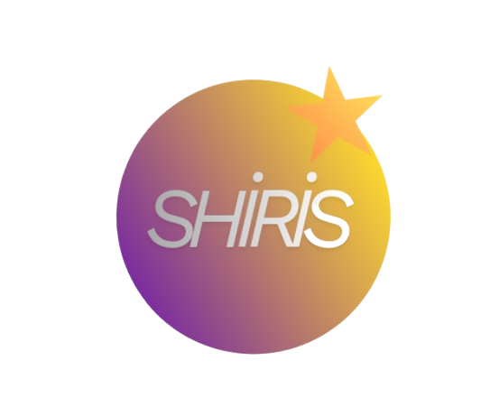

# Shiris

**Shiris**, [Iris Shaders](https://github.com/IrisShaders/Iris) projesinin bir fork'udur. OptiFine shader pack'leriyle uyumlu, Fabric tabanlı modern bir shader modudur.

## Bağlantılar

* **[Modrinth](https://modrinth.com/mod/shiris)** üzerinden indir
* **[GitHub Issues](https://github.com/Dream96969/Shiris/issues)** üzerinden hata bildir
* Shader pack bulmak için **[Modrinth Shaders](https://modrinth.com/shaders)** sayfasını ziyaret et

## Kurulum

1. [Fabric Loader](https://fabricmc.net/use/) yükle
2. [Sodium](https://modrinth.com/mod/sodium) indir ve mods klasörüne koy
3. Shiris `.jar` dosyasını mods klasörüne koy
4. Minecraft'ı başlat → Video Settings → Shader Packs

## Özellikler

* OptiFine shader pack'leriyle tam uyumluluk
* Sodium ile birlikte yüksek performans
* Fabric ve Quilt desteği
* Minecraft 1.21.11 desteği

## Iris'ten Farkı

* Shiris logosu ve marka kimliği
* Mod ID: `shiris` (orijinal Iris ile aynı anda kullanılabilir)
* Yazar: Dream96969

## Bağımlılıklar

| Mod | Zorunlu mu? |
|-----|------------|
| [Fabric Loader](https://fabricmc.net) ≥ 0.12.3 | ✅ Zorunlu |
| [Sodium](https://modrinth.com/mod/sodium) 0.8.x | ✅ Zorunlu |

## Derleme

```bash
./gradlew :fabric:remapJar
```

Çıktı: `build/libs/shiris-*.jar`

## Lisans

Bu proje **GNU LGPLv3** lisansı altında dağıtılmaktadır. Orijinal Iris projesinin bir fork'udur.

`glsl-transformer` bağımlılığı GNU AGPLv3 lisansı kullanmaktadır.

Orijinal proje: [IrisShaders/Iris](https://github.com/IrisShaders/Iris) — Teşekkürler!
